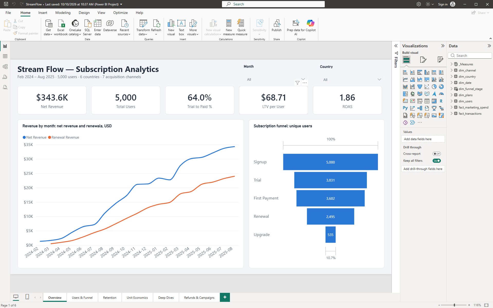
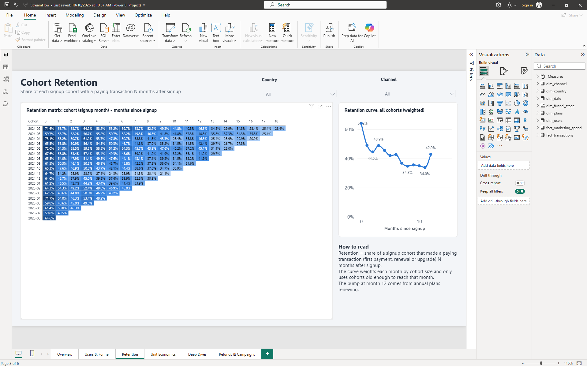
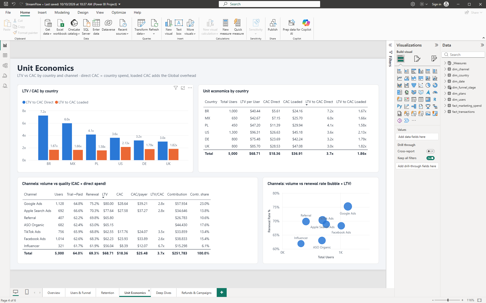
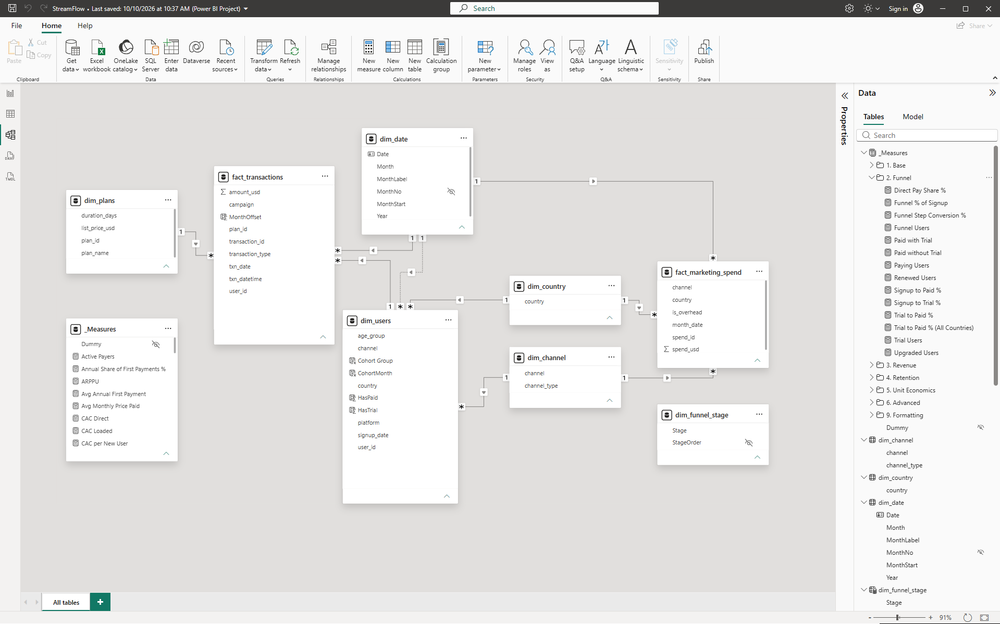
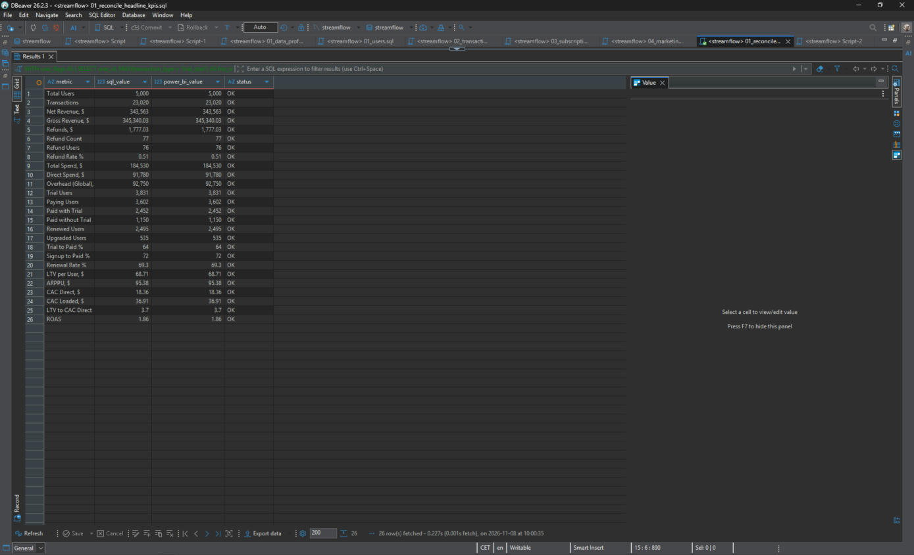
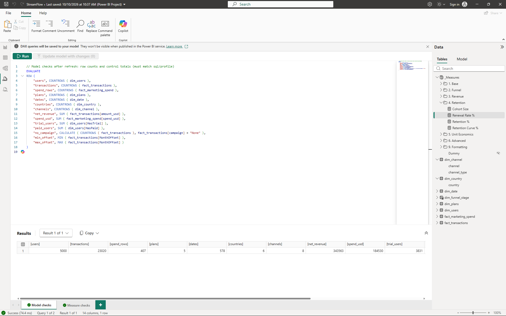
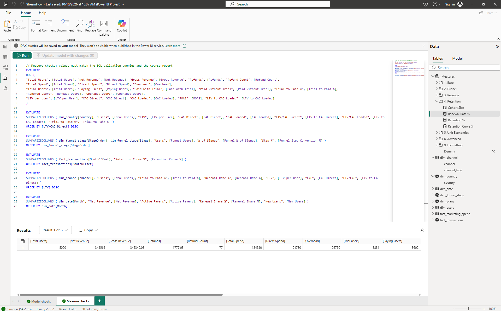
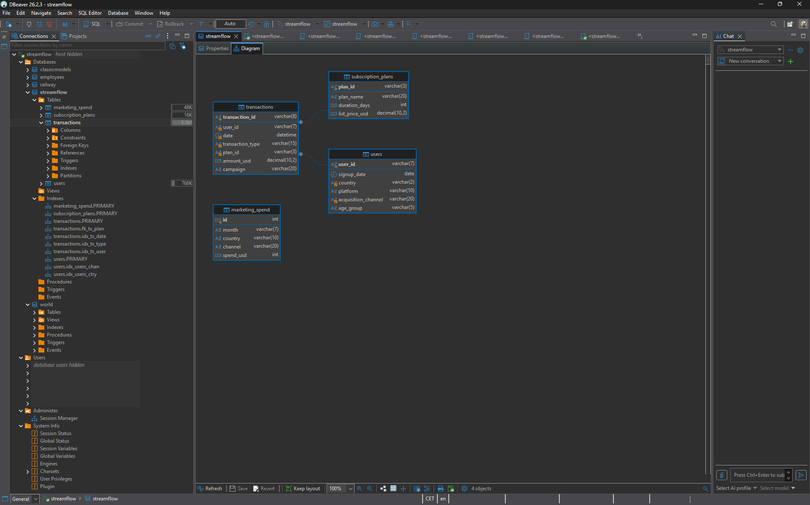

# StreamFlow — Subscription Analytics

End-to-end analysis of a subscription language-learning app: acquisition funnel, revenue, cohort retention and unit economics across 6 countries and 7 acquisition channels.

**Stack:** SQL (MySQL) · DBeaver · Power BI (Power Query, DAX, star schema) · Git

📄 [Written report (PDF)](report/StreamFlow_Report.pdf) · 📊 [Dashboard (PDF)](report/StreamFlow_Dashboard.pdf) · 👤 [Pavlo Renhach on LinkedIn](https://www.linkedin.com/in/pavlorenhach/)



## Key findings

| Area | Finding |
|---|---|
| **Revenue** | $343.6K net revenue over 19 months. Renewals bring 61.9% of it, so keeping payers matters more than winning first payments. |
| **Funnel** | 76.6% of signups start a trial and 64.0% of trials convert to paid. Conversion is strongest in the US (71.8%) and weakest in Mexico (52.7%) and Brazil (55.9%). |
| **Retention** | 64% of a cohort pays in its signup month and 49% one month later. After that it drifts down to about 35% by months 8–11. Annual plans renewing cause a bump at month 12 (42.9%). |
| **Unit economics** | LTV $68.71 per user vs CAC $18.36 (direct spend) or $36.91 (with shared Global overhead), so LTV/CAC is 3.7x or 1.86x (the "ROAS 1.86" card on the Overview page is the same ratio: net revenue ÷ all marketing spend). Brazil has the lowest LTV but by far the cheapest users (7.2x direct). |
| **Channels** | Google Ads makes the largest contribution after its own spend ($57.9K, 23%). Influencer is the cheapest paid channel ($8.39 CAC, 6.7x). |
| **Black Friday** | Half of the Nov 2024 cohort (50.4%) bought Annual at a discounted $30.76, against $51–52 in October and January. The cohort has the lowest LTV of its neighbours ($56.64 vs $64–83). Its M6 retention looks low (25.9% vs about 40%) partly because Annual subscribers pay only once a year. |
| **Facebook Ads** | CAC per new user rose from $36.7 (Feb–Apr 2024) to $54.7 (May–Jul 2024), peaking at $65.6 in June. From August 2024 it was mostly back at $15–25. |
| **Refunds & campaigns** | Refunds are only 0.51% of gross revenue. Email and Push go together with 69% of upgrades (an association; the data cannot prove uplift). Win-back brought back 223 users, and 71.7% of them renewed again. |

LTV here is the revenue a user has actually paid so far (historical LTV), not a forecast.

## Dashboard

Six report pages in Power BI. Every number is a DAX measure. All six pages are also in [one PDF](report/StreamFlow_Dashboard.pdf). The written report is available as [PDF](report/StreamFlow_Report.pdf) and [Word](report/StreamFlow_Report.docx).

| Page | What it answers |
|---|---|
| [Overview](images/dashboard_1_overview.png) | Headline KPIs, monthly revenue vs renewals, subscription funnel |
| [Users & Funnel](images/dashboard_2_users_funnel.png) | Who signs up (country, platform, channel, age) and who converts from trial to paid |
| [Retention](images/dashboard_3_retention.png) | Cohort matrix (19 cohorts × 19 months) and the weighted retention curve |
| [Unit Economics](images/dashboard_4_unit_economics.png) | LTV vs direct and loaded CAC by country, channel quality vs volume |
| [Deep Dives](images/dashboard_5_deep_dives.png) | Black Friday cohort, Facebook Ads cost spike, pricing by country |
| [Refunds & Campaigns](images/dashboard_6_refunds_campaigns.png) | Refund rate, campaign shares of renewals and upgrades, win-back |




## Data model



- **Two fact tables:** `fact_transactions` (23,020 rows) and `fact_marketing_spend` (407 rows).
- **Shared dimensions:** `dim_date` (built in Power Query from the data range and marked as the date table), `dim_country`, `dim_channel` (the 7 acquisition channels plus an 8th row, SMM + Content, for the shared overhead; each tagged Paid / Organic / Overhead), plus `dim_users` and `dim_plans`.
- **Inactive relationship** between `dim_users[signup_date]` and `dim_date`. New-user measures switch it on with `USERELATIONSHIP`, so signups and payments can sit on one time axis.
- **Shared overhead:** "Global" marketing rows (SMM + Content) belong to no country. They are kept apart from direct spend and split by each country's share of users to get the loaded CAC.
- **65 DAX measures** in folders: Base, Funnel, Revenue, Retention, Unit Economics, Advanced. Each one has a description.
- The project is saved as **.pbip** (TMDL + PBIR), so the model, measures and report layout are plain text in [`powerbi/`](powerbi) and can be reviewed in Git.

Example: the weighted retention curve counts, for each month since signup, only the cohorts that are old enough to have reached that month.

```dax
Retention Curve % =
VAR MonthsSinceSignup = SELECTEDVALUE ( fact_transactions[MonthOffset] )
VAR LastMonth = CALCULATE ( MAX ( dim_date[MonthStart] ), REMOVEFILTERS ( dim_date ) )
VAR EligibleUsers =
    CALCULATE (
        [Cohort Size],
        dim_users[CohortMonth] <= EDATE ( LastMonth, - MonthsSinceSignup )
    )
RETURN
    DIVIDE ( [Active Payers], EligibleUsers )
```

## SQL

All SQL was written and run in DBeaver against the MySQL source database.

| Folder | Content |
|---|---|
| [`sql/profile`](sql/profile) | First look at the database: table sizes, time span, dimensions, transaction mix, duplicate keys, missing values, orphan rows |
| [`sql/extract`](sql/extract) | Four extracts loaded into Power BI, one per table. They use explicit columns and clear names and contain no business logic. |
| [`sql/validation`](sql/validation) | Six queries that rebuild the dashboard numbers in SQL (KPIs, funnel, cohort retention, unit economics, campaigns, deep dives) |

The validation queries use CTEs, window functions, conditional aggregation and `PERIOD_DIFF` for cohort months. The first one puts 26 headline numbers next to the values shown in Power BI, and all 26 match.



Inside the model, two DAX queries in [`DAXQueries`](powerbi/StreamFlow.SemanticModel/DAXQueries) run after every refresh: **Model checks** compare row counts and control totals with the SQL profile, and **Measure checks** list the main measures so they can be compared with the SQL results.




## Data profile

Source: MySQL database `streamflow` ([`sql/profile/01_data_profile.sql`](sql/profile/01_data_profile.sql)).

| Table | Rows | Description |
|---|---:|---|
| `users` | 5,000 | One row per user: signup date, country, platform, acquisition channel, age group |
| `transactions` | 23,020 | Trials, first payments, renewals, upgrades, refunds |
| `marketing_spend` | 407 | Monthly spend by country and channel |
| `subscription_plans` | 5 | Plan catalogue and list prices |
| **Total** | **28,432** | Feb 2024 – Aug 2025 (19 months) · 6 countries · 7 channels · 3 platforms · 5 age groups |



**Data-quality notes**

- No duplicate keys and no orphan transactions (every transaction matches a user and a plan).
- 19,794 transactions have no campaign: organic payments, kept as "None".
- The Lifetime plan has no duration (it never expires).
- 77 refunds are stored as negative amounts (−$1,777 in total), so net revenue = sum of all amounts.
- 19 marketing rows have country `Global` (SMM + Content): shared overhead that is not tied to a country.

## How to run it

1. Run the four queries in [`sql/extract`](sql/extract) and save each result as CSV (UTF-8, comma, header) into one folder: `users.csv`, `transactions.csv`, `subscription_plans.csv`, `marketing_spend.csv`.
2. Open `powerbi/StreamFlow.pbip` in Power BI Desktop.
3. Set the `DataFolder` parameter (Transform data → Manage parameters) to that folder, then click **Refresh**.

## Repository structure

```
sql/profile/      data profile and quality checks
sql/extract/      the four extracts loaded into Power BI
sql/validation/   SQL cross-checks of the DAX results
powerbi/          Power BI project (.pbip: model, measures and report as text)
report/           written report (PDF, Word) and dashboard export (PDF)
images/           dashboard pages, data model, ER diagram
```

## Data and privacy

The dataset comes from a Data Loves Academy course project and is not included in this repository. Database credentials are never stored in the project files.

---

**Pavlo Renhach** — Data Analyst, Helsingør, Denmark · [LinkedIn](https://www.linkedin.com/in/pavlorenhach/) · [GitHub](https://github.com/pldbin)
